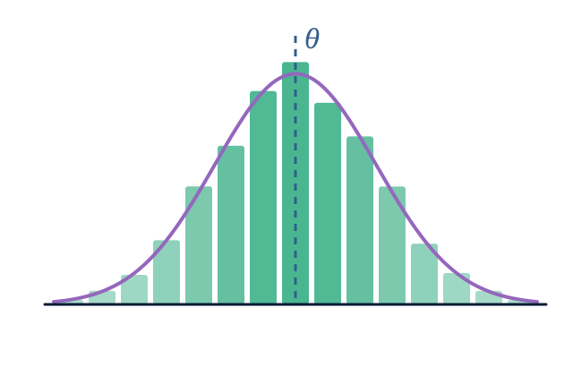

<h1 class="home-title">STT-7360</h1>

Méthodes biostatistiques · Hiver 2027

Un cours de formation à la recherche pour la maîtrise et le doctorat : données corrélées, théorie semi-paramétrique, données manquantes, erreur de mesure et tests multiples, abordés en lisant, en reproduisant et en étendant des articles méthodologiques.

<a class="home-action home-action--primary" href="plan-de-cours.html">Plan de cours</a>
<a class="home-action home-action--secondary" href="calendrier.html">Calendrier</a>
<a class="home-action home-action--secondary" href="projet.html">Projet de recherche</a>

